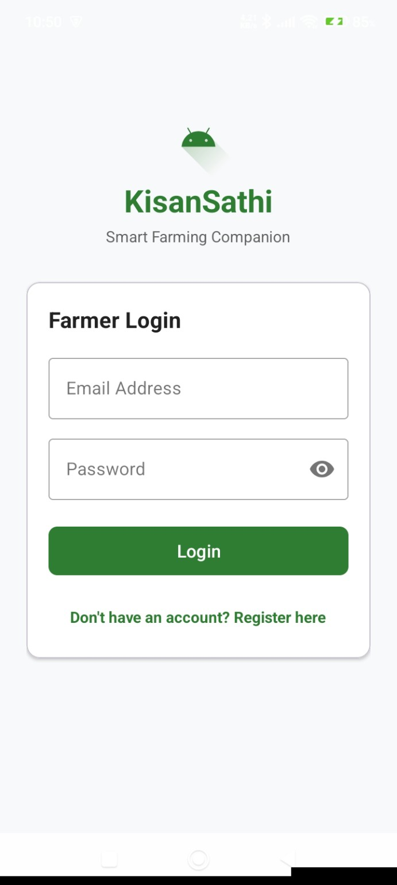
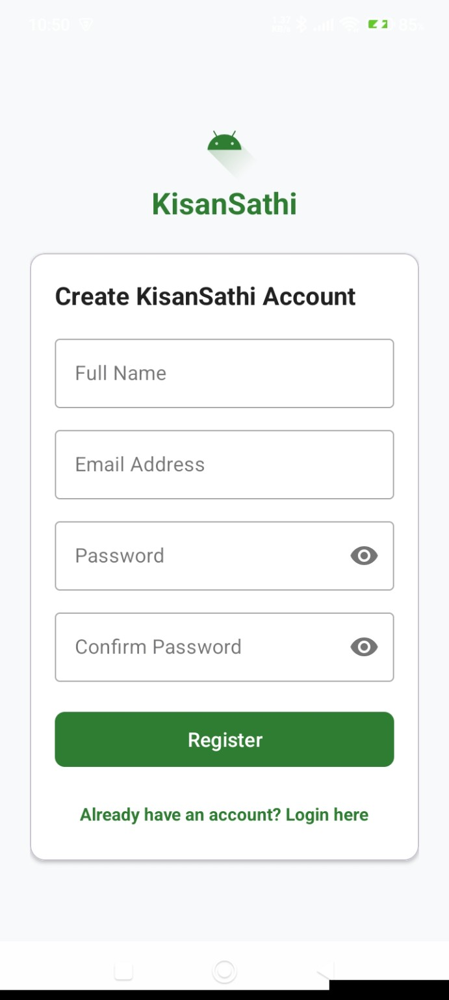
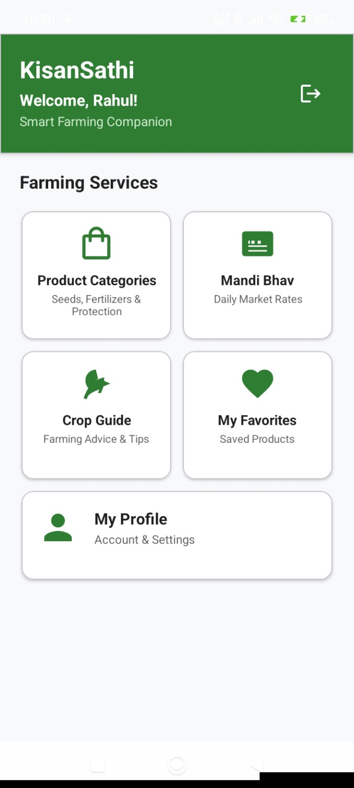
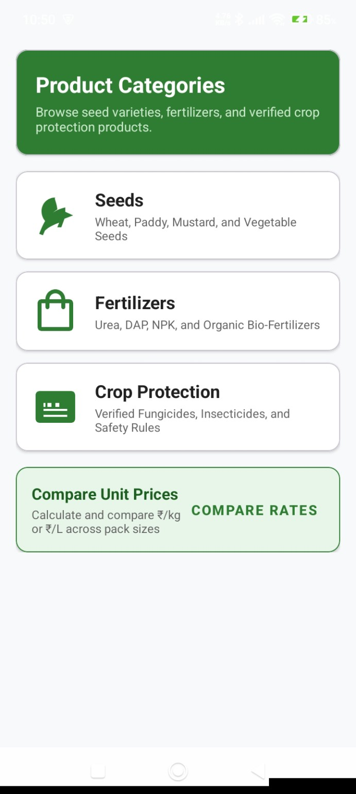
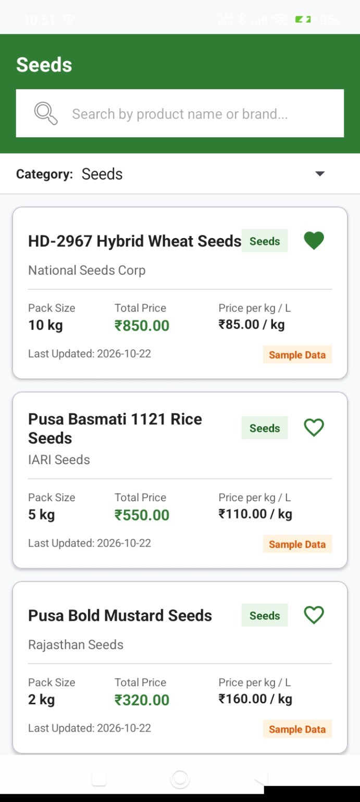
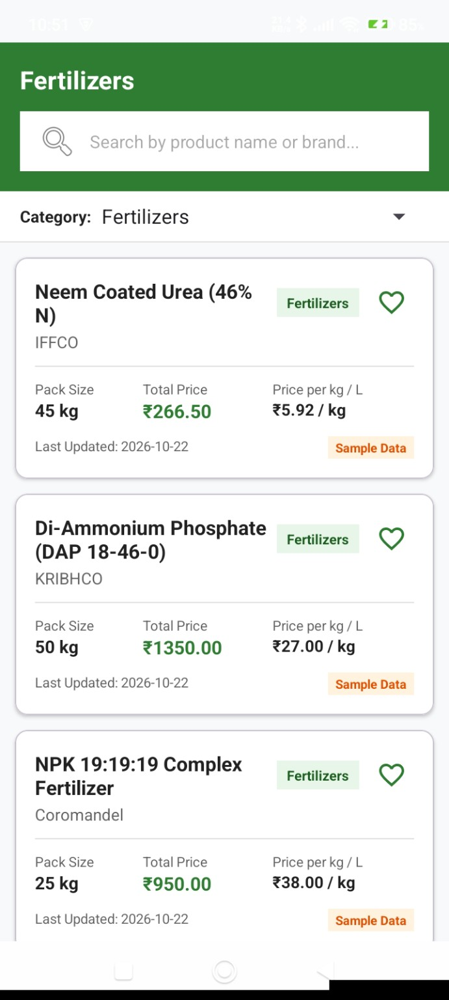
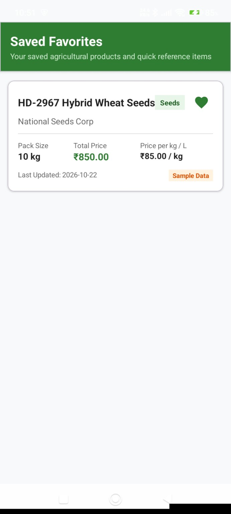
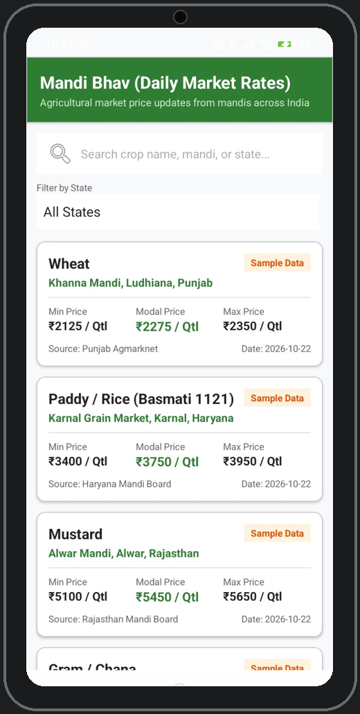
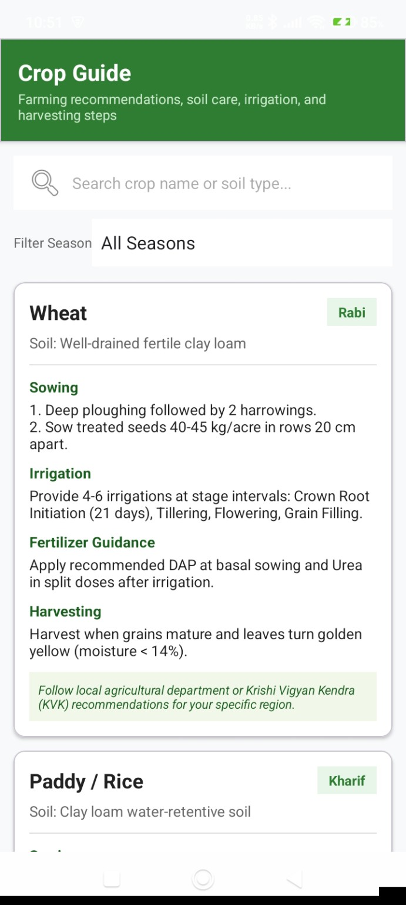
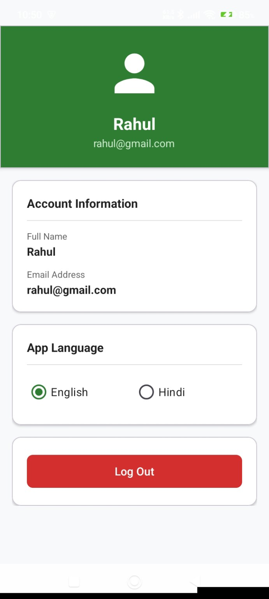

# 🌱 KisanSathi – Smart Farming Android Application

**Smart Farming Companion | स्मार्ट खेती का साथी**

KisanSathi is an Android application designed to help farmers access agricultural products, compare prices, check mandi prices, and get useful crop information in one place.

## ✨ Features

- User Registration and Login
- Agriculture Product Categories
- Product Listing and Details
- Product Price Comparison
- Mandi Price Information
- Crop Guide
- Favorites Management
- User Profile
- Hindi and English Language Support

## 🛠️ Technologies Used

- **Language:** Java
- **UI:** XML
- **Platform:** Android Studio
- **Backend:** Firebase
- **Authentication:** Firebase Authentication
- **Database:** Firebase Realtime Database
- **Build System:** Gradle

## 📱 Application Modules

1. Splash Screen
2. Login and Registration
3. Main Dashboard
4. Product Categories
5. Product Details
6. Price Comparison
7. Mandi Prices
8. Crop Guide
9. Favorites
10. User Profile

## 🚀 How to Run

1. Clone this repository.
2. Open the project in Android Studio.
3. Configure your Firebase project.
4. Add your `google-services.json` file inside the `app` folder.
5. Sync Gradle.
6. Run the application on an Android device or emulator.

## 👨‍💻 Developer

**Rahul Guleriya**

B.Tech CSE Student

## 📌 Project Status

Android application project developed using Java, XML and Firebase.
---

## 📱 App Screenshots

### 1. Login & Registration

### 2. Home Dashboard

### 3. Product Categories

### 4. Product List

### 5. Product Details

### 6. Price Comparison

### 7. Mandi Prices

### 8. Crop Guide

### 9. Favorites

### 10. Profile

### 11. Additional Screen

